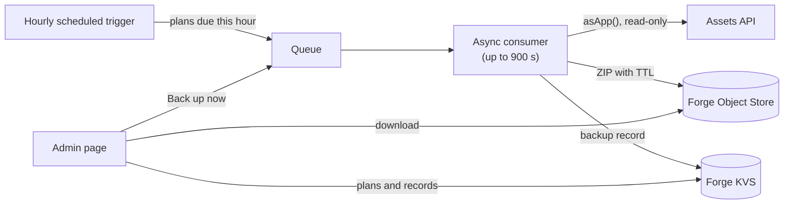

<div align="center">

# 💾 Assets Backup

**Scheduled backups for Jira Service Management Assets schemas, built as a private Atlassian Forge app.**

Backups on per-plan schedules with retention you choose. Admins create plans, watch runs and download ZIPs from one page in Jira.


</div>

---

## ✨ Why

Assets schemas hold critical configuration. A misclick or a bad script can change or wipe objects in minutes. Assets Backup keeps recent copies of the schemas you choose, taken automatically, so you can check what the data looked like before the mistake and download it.

It is a safety net for mistakes, not disaster recovery: restoring a backup into Assets is not part of this app.

| | |
|---|---|
| 🔒 **App account** | Reads Assets as the app (`asApp()`), read-only, and sees only schemas where the app account has a role. |
| ⏰ **Schedules** | Up to 20 plans, each with its own schemas, weekdays, start hour (Europe/Copenhagen) and retention of 1 to 30 days. |
| 📦 **ZIP format** | The package of the export app (`it-operations-forge-assets-export`), format version 2. |
| 🗂️ **Visible problems** | Unreadable schemas and failed object types show up on the plan card and in the backup's `manifest.json`. |
| 🗑️ **Auto-cleanup** | Backups expire after the plan's retention (Object Store TTL, plus a cleanup in the hourly trigger). |
| 🌗 **Atlassian look** | Atlassian design tokens, light and dark theme, native Jira flags, no remote assets. |

## 🖥️ Admin page

Open it in **Jira settings → Apps → Assets backups**.

- **Overview**: number of plans (paused, needing attention), size stored now and a storage forecast. The forecast is an estimate, not usage reported by Atlassian.
- **Plan card**: a status lozenge (Paused, Failed, Incomplete), the next backup, the schedule, schemas, retention, stored size, the last backup with Download, the last 14 runs (failed runs are taller red ticks, with a text summary) and the full history.
- **Back up now** runs a plan right away. The page refreshes by itself while a backup runs and shows a Jira flag when it completes or fails.
- **Edit** opens the plan form in place of the card. Errors show under the field they belong to. **Delete plan** is in the form, asks for confirmation and is blocked while a backup of the plan runs.
- Works with the keyboard and screen readers, on a 375 px wide screen and with 200% text size.

## 🧭 How it works



- Every hour the trigger queues the plans whose weekday and hour match the current Europe/Copenhagen time. It also deletes expired backups and marks runs stuck in "running" as failed.
- The consumer reads the plan's schemas through `asApp()`, builds one ZIP and uploads it to Forge Object Store with the plan's retention as TTL. The outcome is stored as a backup record in Forge KVS.
- The admin page reads plans and backup records through a resolver and downloads ZIPs through pre-signed URLs.
- Logs contain only status, timing and counts, never object data.

## 🗄️ Stored data

| Where | What |
|---|---|
| Forge Object Store | One ZIP per run: `backups/{planId}/{YYYYMMDDTHHMMSSZ}.zip` (UTC start time) |
| Forge KVS | `plan:{id}` plans, `slot:{id}` last scheduled hour, `backup:{planId}:{stamp}` one record per run |

A downloaded file is named after the plan and its start time in Copenhagen time, for example `assets-backup-nightly-services-2026-10-26-1824.zip`.

Each ZIP is the export app's package, format version 2:

```text
manifest.json                   root manifest, lists the schema folders
references-missing.csv          optional: referenced objects that are not in the backup
{schemaKey}/
  {objectType}.csv              for people and Excel, not for restore
  overview.csv                  one row per object type
  data/manifest.json            object types with status and counts
  data/schema.json              object types and attribute definitions
  data/objects-{typeId}.ndjson  one object per line: the data a restore would use
```

**Root manifest fields:**

| Field | Description |
|---|---|
| `formatVersion` | `2` |
| `exportedAt` | UTC start time of the backup |
| `app` | `{ name, version }` of this app |
| `workspaceId` | Assets workspace |
| `filter` | Always `null`: every object type is backed up |
| `schemas` | `[{ id, key, name, folder, status }]`, where status is `complete`, `partial` or `failed` |
| `missingSchemas` | Keys of plan schemas the app account could not read |

Emails, avatars and media tokens are never written. The full format is in [docs/backup-format.md](docs/backup-format.md).

> [!WARNING]
> Deleting a plan deletes all its backups. They can't be recovered. To stop backups but keep the stored ones, turn off **Run on schedule** instead.

## 🔑 Scopes

| Scope | Why |
|---|---|
| `read:servicedesk-request` | Find the Assets workspace (`/rest/servicedeskapi/assets/workspace`) |
| `read:cmdb-schema:jira` | List schemas |
| `read:cmdb-type:jira` | List object types |
| `read:cmdb-object:jira` | Read objects with AQL |
| `read:cmdb-attribute:jira` | Read attribute definitions |
| `storage:app` | Forge KVS: plans, schedule state and backup records |

There are no write scopes. Forge Object Store needs no scope.

## ⚙️ Configuration

Plans are created and edited on the admin page. Each plan has:

| Field | Values | Default |
|---|---|---|
| **Plan name** | 1 to 80 characters | none |
| **Schemas to back up** | Schemas the app account can read | none |
| **Days** | Any of Mon to Sun | Every day |
| **Start at** | 00:00 to 23:00, Europe/Copenhagen | 02:00 |
| **Keep each backup for** | 1 to 30 days | 7 |
| **Run on schedule** | On, or off to pause the plan (Back up now still works) | On |

Access is enforced by Assets: give the app account a role in each schema to back up (**Object schema → Roles**). A plan schema the account can't read is not skipped silently: it is listed in `missingSchemas` and flagged on the plan card.

## 🛠️ Development

Requires Node 24 and the [Forge CLI](https://developer.atlassian.com/platform/forge/getting-started/).

```bash
npm install
npm --prefix static/main install
npm test                               # Vitest
npm --prefix static/main run build     # forge deploy does NOT build the UI
forge lint
```

<details>
<summary><b>Project layout</b></summary>

```text
manifest.yml.example   template, copy to manifest.yml
src/
  index.js             trigger, consumer and resolver entry points
  jobs.js              hourly tick and the backup run of one plan
  plans.js             plans, schedule slots and backup records in Forge KVS
  backup.js            builds the ZIP and uploads it to Object Store
  api/, export/        Assets client and ZIP builder, ported from the export app
static/main/           admin page (Custom UI, React + Vite)
test/                  Vitest
docs/                  backup format and spike results
```

</details>

## 🚀 Private install

`manifest.yml` is not committed because it holds the registered app id. Create it from the example, then run `forge register` once:

```bash
cp manifest.yml.example manifest.yml
forge register
```

These commands change a remote environment, so run them yourself:

```bash
# Development
npm --prefix static/main run build
forge deploy -e development
forge install --site <site>.atlassian.net --product jira -e development
forge logs -e development

# Production
npm --prefix static/main run build
forge deploy -e production
forge install --site <site>.atlassian.net --product jira -e production
```

When a later deploy adds scopes or modules, upgrade the existing installation:

```bash
forge install --upgrade --site <site>.atlassian.net --product jira -e production
```

Uninstall with `forge uninstall`. Delete the plans first if their backups should go too: what Forge does with stored data on uninstall has not been tested.

## ⚠️ Known limitations

- **No exact timing**: the hourly trigger fires once an hour at a fixed minute, so a plan starts at some point within its hour .
- **Clock changes**: when clocks go back, the repeated hour runs the plan once; when clocks go forward, a plan set to 02:00 skips that night.
- **No restore**: the app creates and keeps backups. Restoring into Assets needs a separate import app.
- **No external egress**: backups stay in Forge Object Store; there is no Azure Blob, S3 or other external storage.
- **Object Store is a Forge Preview feature**: its storage price is not published, and it has not been tested in the production environment yet.
- **Limits**: at most 20 plans; one backup run may take up to 900 seconds.

## 📊 Performance

Backup duration and ZIP size depend on the number of objects and their attributes. Test representative workloads against the 900 second consumer limit.

## 🔗 Related

- [it-operations-forge-assets-export](../it-operations-forge-assets-export): the export app whose code this app builds on
- [Backup format](docs/backup-format.md)
- [Spike results](docs/spike-results.md): proof that `asApp()` can read Assets from a scheduled trigger, Object Store tests and measurements

## 📜 License

This project is licensed under the [MIT License](LICENSE).

---

*Status: v1*
